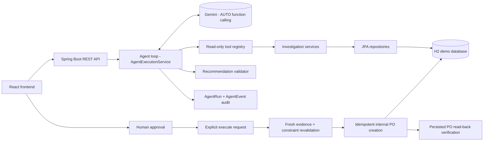
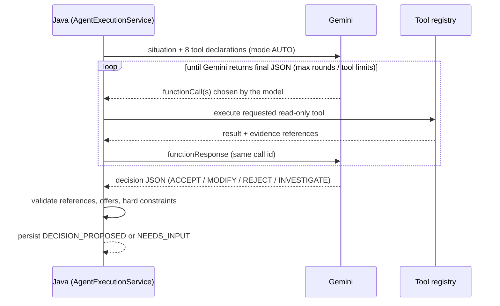

# ProcureAI architecture

## Agent loop: who decides what

- **Gemini decides** which tools to call, in what order, whether to ask follow-up questions, and the proposed decision.
- **Java decides** what is allowed: tool execution limits, validation of every evidence reference against the current run,
  hard business constraints, human approval, and execution safety. Java does not compute a decision before asking the model.

## Feedback loop after a decision

1. **Approval** binds the run's evidence snapshot fingerprint, quantity and supplier offer.
2. **Execution** recomputes the evidence. If anything material changed, or a constraint now fails, execution is `BLOCKED`
   and a new investigation is required.
3. **PO creation** uses an idempotency key derived from the approval, so retries return the existing PO.
4. **Read-back** reloads the PO from the database and verifies supplier, warehouse, status, line quantity, price and offer.
   A mismatch marks the execution as failed instead of reporting success.

## Failure diagnostics

Gemini transport and API errors are classified as AUTHENTICATION, RATE_LIMIT, TIMEOUT or API_FAILURE. They are stored in the
`RUN_FAILED` event with a sanitized cause chain: up to 4 levels of class name and redacted message, with no stack traces,
headers, payloads or keys. The SDK applies its timeout as OkHttp's whole-call timeout; when it expires OkHttp throws
`InterruptedIOException("timeout")`, which is classified as TIMEOUT.
